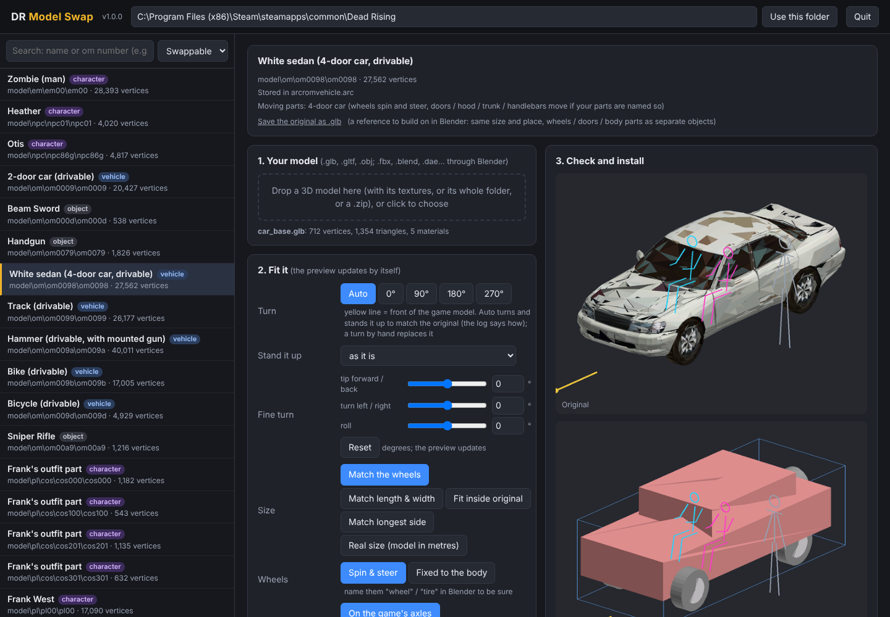

# DR Model Swap

Put your own 3D models into **Dead Rising (PC, 2016 Steam release)**: weapons and items, the drivable vehicles, and
characters (Frank, survivors, psychopaths, zombies). Pick a model from the game, drop in a 3D model, check the preview,
click **Install**. No Blender skills needed: the tool turns, sizes, rigs and converts the model for you, and shows you
what it did so you can correct it.



## Highlights

- **Every object, vehicle and character model in your game**, listed with the game's own names: search "bat", "cart",
  "om0098", "Otis", "zombie"...
- **Drag and drop**: `.glb`, `.gltf`, `.obj` directly; `.fbx`, `.blend`, `.dae`, `.3ds`, `.stl`, `.ply`, `.x3d`, `.usd`,
  `.abc` through Blender (if installed: it runs in the background, you never open it). Drop the file, its whole folder, or
  a `.zip`; textures are found automatically.
- **Automatic turn and size**: the model is turned to stand like the original (even models drawn at a slant), and sized
  like it (vehicles by length and width, characters by height, weapons by length). The preview shows the size in metres
  next to a person of Frank's height.
- **Vehicles drive like the originals**: your wheels spin and steer (four, three or two wheels), doors, hood, trunk,
  steering wheel and handlebars move with the game's parts, and Frank sits in your model's driver seat (no other mod
  needed; with the co-op mod both players sit in your model's seats).
- **Characters animate**: your model is rigged to the game's skeleton automatically, A-poses are straightened, legs and
  arms are fitted to the game's joints so knees and elbows bend in the right places, the head moves as one piece.
- **Parts list**: see what the tool took each piece to be (wheel, door, head, body...), change it, or leave pieces out
  (stands, ground planes).
- **Problems found ahead of time**: before anything goes in the game, the tool checks for what would look wrong there:
  faces that would show as holes, cloth that would stretch when a character walks, legs or arms stretched to fit,
  where a gun sits in Frank's hand. It fixes what it safely can, says so (with a button to undo), and offers the setting
  that helps for the rest. A **see-through check** picture shows holes in magenta; the **moving parts check** shows
  stretched spots in orange.
- **Safe**: every game file is backed up before the first change; **Restore** puts the originals back byte for byte.
  The game's code isn't touched, only its data files.

## Download and start

**Windows, simplest**: download `DRModelSwap.exe` from the [Releases](../../releases) page and double-click it.
Nothing else to install. (Windows may warn that the file is from an unknown publisher, because it isn't code-signed:
**More info → Run anyway**.)

**Windows, with Python**: download the release zip, unpack it, double-click **`Start DR Model Swap.bat`**. The first start
sets up its own Python environment in that folder (needs Python 3.9 or newer from python.org, and internet once).

**Any system, from source**:

```
pip install -r requirements.txt
python DRModelSwap.py
```

A small console window opens and the tool opens in your web browser. It runs only on your own computer (127.0.0.1, with
a random key so no web page can talk to it). Close the console window or press **Quit** to stop it.

## How to use it

1. Point it at your Dead Rising folder (the one with `DeadRising.exe`; it suggests the usual Steam folders it finds).
   The first scan takes a few seconds.
2. Pick a game model on the left (filter **Vehicles** / **Objects** / **Characters**, or search).
3. Drop your model on **1. Your model**.
4. Look at the preview: the original on top, yours below (blue box = the original's size, grey figure = a person
   1.83 m tall, red = Frank's hand for things he holds). Vehicles and characters get the **moving parts check**: wheels
   turned and steered, doors opened, a character walking (stretched spots in orange). The **see-through check** shows the
   model from the front and from behind with the backs of faces in magenta: the game doesn't draw those, so magenta
   that shows is a hole in the game.
5. Read **Problems found ahead of time** under the pictures: what was fixed automatically (each with a way back) and
   what to check, with buttons for the settings that help. The log under it says everything that was found and done.
6. Fix what's wrong (see below). The preview updates by itself.
7. **Close the game**, click **Install into the game**, start the game.

To undo: **Restore the original** on that model, or **Restore every original** at the bottom. Each game model remembers
the file you gave it and its settings, and an installed swap keeps a copy of the file it was made from, so you can come
back later and change it without picking the file again.

Everything the tool keeps is in `<game folder>\DRModelSwap\`: backups of the original game files, your converted
swaps, the files they were made from, and the list of what's installed. **To play with friends, everyone needs the
same swaps installed** (send them your model and settings, or the changed game files).

## Settings

| setting | what it does |
|---|---|
| **Turn** | **Auto** (default): of the 24 ways the model can lie, the one that lies best over the original. Models drawn at a slant (a Minecraft sword is diagonal in its file) are straightened first. Characters: standing, feet down, toes forward. Vehicles: wheels underneath, length front to back. Hand-held things: the end that's held where the original is held. Or pick 0° / 90° / 180° / 270° (the yellow line is the front). |
| **Stand it up** | For models lying on their side or back (Z-up exports). |
| **Fine turn** | Any angle around each axis, on top of the above. |
| **Size** | Chosen by kind: vehicles **Match the wheels** (the original's ground area, at most 1.3× its length or width and 1.8× its height, then nudged by at most 15% so your wheelbase sits on the game's axles), characters **Same height**, objects **Match longest side**. Or: *Match length & width*, *Fit inside original*, *Real size* (model in metres, 1 m = 100 game units). |
| **Scale** | 0.05× to 20× on top (type a number for more than 5×). |
| **Place** | On the original's ground (default), centred, or at the model's own origin. |
| **Faces** | **Fix inside-out faces** (default): the game draws only the front of each face, so faces turned inwards would be holes; they're turned round (each connected surface is made to agree with itself, and a closed one to face outwards). Thin open surfaces of materials marked double-sided in the file (single-layer cloth, leaves, hair cards) get a back. *Draw both sides*: every face two-sided (doubles the vertices). *As in my file*: nothing changed. |
| **Textures up to** / **Vertex budget** | Texture size (64 to 2048) and the most vertices (the game's limit is 65,536 per model; bigger models are thinned). |

### Vehicles

The six drivable vehicles (2-door car, 4-door car, Track, Hammer, Bike, Bicycle) have skeletons: a bone per wheel that
spins around the axle, hubs that steer, bones for doors, hood, trunk, steering wheel, handlebars, fork, swingarm, pedals.

- **Wheels** are found by name (*wheel*, *tire/tyre*, *rim*, *hubcap*... in object, mesh or material names; a *spare*
  stays on the body) or by shape (round pieces with a sideways axle, low down, including a cartoon car's small wheels).
  Tyre, rim, hub cap and bolts of one wheel spin together; a brake calliper steers but doesn't spin.
- Each wheel is moved onto the game wheel's axle at its corner and resized to the game's wheel (the game's physics drives
  on its own wheels). Axle rods and parts on the axle line move with it.
- **Three wheels**: a single front or back wheel in the middle spins and steers around the middle.
  **Two wheels**: bikes.
- Named **doors**, **hood/bonnet**, **trunk/boot/tailgate**, **steering wheel**, **handlebar**, **fork**,
  **swingarm**, **crank/pedals** move with the game's matching part (around the game's hinges).
- **Wheel size**: the game's (default) or yours. **Wheels sideways**: where they are, or the game's track width (the body
  is stretched with them). **Wheel position**: on the game's axles (default) or *where my model has them (test)*: the
  game's wheel bones move to your wheels instead (untested in the game).
- **Riders**: the driver (blue) and passenger (pink) are shown in the preview. Your model's seats are found from a named
  steering wheel or handlebar, or from the seats' shape (a cushion with a backrest), near where the original has its
  seats; *Driver seat* / *Passenger seat* correct them by hand (up to 300 with the sliders, 400 typed; a car is about
  470 long). The game always seats Frank in the original's driver seat, so there are two ways to line them up:
  - **Fit my model to Frank's seat** (default, works in any game): your model is moved so its driver seat is where the
    game seats Frank. The wheels stay on the game's axles; the move is limited (80 sideways or front to back, 30 up,
    down as far as the body's clearance over the ground) and the log says if Frank still sits some way off (Scale
    helps then).
  - **Riders in my model's seats (co-op mod)** (default when the **Dead Rising co-op mod** is installed): your model
    stays where it is and the mod (v31i or newer) draws both players in its seats, reading `DRModelSwap\seats.txt`
    (written on Install).
  - *Where the original's are*: nothing is moved.

### Characters

Frank (pl00), survivors (npc..), psychopaths (em4..g) and zombies (em00..) share one skeleton.

- **Pose: automatic**: an A-pose (or other arm / leg angle) is measured and straightened into the game's T-pose, so arms
  don't twist when animated. The log shows the angles found. *As it is* skips this.
- **Body: fit to the game's joints**: the game's animations fix the hip height and bend the body at the game skeleton's
  knees, elbows and shoulders, so legs and arms are stretched or shortened until your knees, elbows and wrists meet the
  game's (a short-legged ogre gets longer legs). The log shows the factors. *Keep my proportions* only scales it.
- **Weights from the game character**: every vertex takes the bone weights of the nearest part of the original body,
  smoothed along your mesh. The head (and hair, hats, glasses, when they're separate pieces, as in most models) moves as
  one piece with the head bone, sealed to the collar so no gap opens at the neck. Rigged models are read in their rest
  pose; their own rig isn't needed.
- **Where the legs part**: found from the triangles (the gap between the legs; baggy trousers or a narrow gap don't fool
  it) or set by hand (% of the height). If the legs come out stretched a lot, the Problems list says so and offers it.
- **Between the legs: cut down the middle** (default): cloth joining the two legs (a web of trousers, a robe) would be
  stretched across whenever the legs move apart; it's cut along the middle so each half moves with its own leg.
- **Legs and arms: each follows its own side** (default): wide trousers or sleeves can be nearer the other leg or the
  body; they take weights only from their own leg's or arm's bones, so nothing is pulled across.
- **Stretch check**: your character is bent in test poses (walking, crouching, elbows bent, head turned) and every
  triangle that stretches a lot is found, compared with the game's own model, named by joint in the Problems list and
  drawn orange in the moving parts check.
- Drawn in the display groups of the original's body parts, **and of every other part that covers the same place**:
  zombies switch groups on and off for their clothing variants (long or short sleeves, trousers or shorts), and a
  triangle drawn only with the bare-arm groups would vanish on a long-sleeved zombie. One texture for all materials.
- **Far away** (zombies): the game draws simpler versions further away. A light model (up to 8,000 vertices) is drawn
  whole at every distance; heavier ones get thinned copies (thinning keeps fronts and backs apart and triangles facing
  the right way). *Whole model* / *Thinned copies* choose by hand.
- **Frank**: his starting clothes are hidden so they don't cover your model (they come back with Restore); clothes he
  changes into later still show.

### Things Frank holds

The game holds an item at its origin: Frank's hand (the red cube in the preview; the red line runs up his forearm).

- **Hold: find the handle** (default): a model with a handle under its body (a gun) gets the top of its handle put in
  Frank's hand and its front forwards (turned round if it was backwards: a handle leans back, a barrel is the longer
  side). Placed like the original holds its own handle when the original has one. Models without a handle fill the
  original's space as before.
- **Move in the hand**: sideways / up / forward, up to 100 with the sliders, 200 typed (a pistol is about 30 long).
- A model made with its grip at its own origin can use **Place: keep .glb origin**.

### Parts list

After the first preview, every piece of your model is listed with what the tool took it to be and roughly where it is;
**Show** draws a box round it in the preview. Change what's wrong:

- vehicles: *body (doesn't move)*, *wheel*, *steering wheel*, *door*, *hood*, *trunk*, *handlebar*, *fork*,
  *swingarm*, *pedals*;
- characters: *head* (moves as one with it), *body*;
- anything: **Leave out** (a display stand, a ground plane, a figure inside a car...).

A flat base the model stands on (a ground plane or plate) is left out automatically and listed, so you can keep it.

### Files

- **.glb** is best (one file with everything). **.gltf** (with its .bin and textures) and **.obj** (with its .mtl and
  textures) are read directly; vertex colours (models painted without a texture) become a small texture.
- **.fbx, .blend, .dae, .3ds, .stl, .ply, .x3d, .usd, .abc**: opened by **Blender** (free, blender.org) in the
  background, if installed. The tool finds it in Program Files, Steam or the Microsoft Store, or asks where it is once.
- Several files at once, a whole folder or a `.zip`: textures are found by their path, or by name if the path points to
  someone else's computer. Anything missing is listed and drawn in plain colour.
- Base colour textures and colours are used. Normal, roughness and transparency maps aren't (glass comes out solid).
  Animations are ignored.
- **Save the original as .glb** exports the game's model (same size and place, moving parts as separate named objects)
  as a guide to build on in Blender. For your own use; don't share game assets.

## Command line

```
python -m drmodelswap list    "C:\...\Dead Rising" sword
python -m drmodelswap swap    "C:\...\Dead Rising" om0098 my_car.glb
python -m drmodelswap swap    "C:\...\Dead Rising" om0098 my_car.fbx --yaw 90 --size footprint --scale 1.2
python -m drmodelswap swap    "C:\...\Dead Rising" npc86g my_person.glb
python -m drmodelswap restore "C:\...\Dead Rising" om0098        (or --all)
python -m drmodelswap export  "C:\...\Dead Rising" om0098 reference.glb
```

`swap --help` lists every option (turn, size, wheels, seats, pose, body, faces, grip, `--hold X Y Z`, crotch, webs,
limbs, lods...). Without `--yaw` / `--tilt` the model is turned automatically. The Problems list is printed with the
options that help.

## Known limits

- **Looks only.** The game keeps the original's collision, physics, damage and handling: a vehicle drives like the one
  it replaced, a weapon hits like the original weapon.
- Vehicle damage: the game hides the original's dented parts as it gets damaged; a new model is always drawn whole.
- Effects the game draws itself (fire, sparks, a beam sword's glow) stay as they are.
- Objects that aren't vehicles or characters move as one piece.
- Characters: fingers and faces don't animate beyond the game's 23 bones; skirts and long coats follow the thighs.
- Zombie clothing variants: which display groups the game turns on for which zombie isn't in the model file, so the
  tool draws each part of your model with every group that covers that place. That costs some extra drawing; holes
  should be gone, but check a few zombies in the game.
- Where Frank holds a gun is matched to the game's own guns (within a few cm for the handgun); unusual shapes may need
  Move in the hand.
- A vehicle saved facing backwards may need a click on 180° (front and back can look alike to the automatic turn).
- Very detailed models (over about 60,000 vertices) are thinned automatically, roughly; a preview of one with 100,000+
  triangles can take a minute. Reducing it in Blender first (Decimate) looks better and is faster.
- Cutscene models, some of Frank's outfit parts and level geometry use other layouts and aren't offered.
- Tested on the 2016 Steam release, mostly by converting models offline and checking the results; tell us what looks
  wrong in the game (an issue with the model file, the game model and a screenshot helps most).

## How it works

`docs/FORMAT.md` describes the game's file formats (ARC packages, MOD models, TEX textures, skeletons, the animation data
that fixes the hip height). The code:

| file | job |
|---|---|
| `arc.py` | the game's `.arc` packages (zlib-compressed entries) |
| `mod.py`, `tex.py` | read and write MOD models (quantised positions, strips, bones, display groups, LODs) and textures (DXT) |
| `glb.py`, `objfile.py`, `models.py`, `blender.py` | reading models: glTF, OBJ, files picked together / folders / zips, other formats through Blender, vertex colours |
| `orient.py` | the automatic turn (shape match, straightening, clues per kind) |
| `pieces.py` | the Parts list, leaving pieces out, flat bases |
| `convert.py` | placement, sizing, thinning, texture atlas, building the replacement |
| `vehicle.py`, `seats.py` | wheels and moving parts on the game's bones; seats |
| `rig.py`, `character.py` | skeletons, posing; character weights, pose straightening, fitting to the joints, rigid heads |
| `render.py` | the preview pictures |
| `game.py`, `names.py` | the game folder: models, backups, install / restore, names from `DeadRising.exe` |
| `server.py`, `web/index.html` | the browser window (local only, token-protected); `cli.py` the command line |

Tests (they need your own game folder; nothing from the game is included here): `tests/smoke.py` converts, installs and
restores one model and checks the game files come back byte-identical; `tests/rigs.py` puts test cars and the game's own
models onto every vehicle and character and checks wheels, axles and bending; `tests/formats.py` checks the glTF / OBJ
readers against `.glb` files you give it.

## Legal

Not affiliated with or endorsed by Capcom. This repository contains no game files or game assets; you need your own
copy of the game. Only use models you have the right to use, and respect their licences when you share swaps.

## License

MIT (see `LICENSE`).
